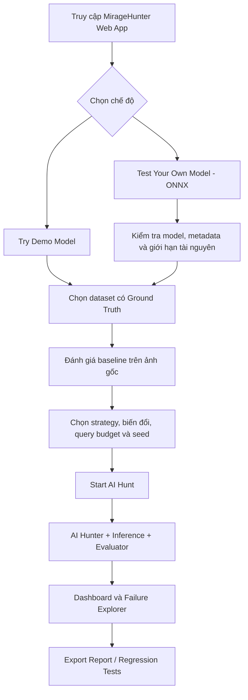
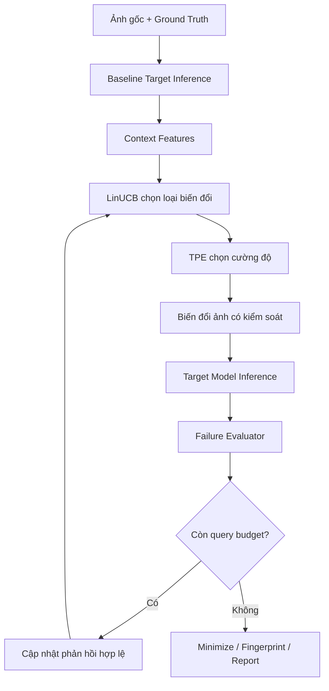

# MirageHunter AI

> **Discover weaknesses before deployment.**  
> **Nền tảng kiểm thử tự động các mô hình Machine Learning và Deep Learning, tập trung vào phát hiện lỗi có thể tái lập.**

**Team:** H2T  
**Hackathon:** [Kiroween 2026](https://kiroween.devpost.com/)  
**Category:** Frankenstein  
**Bonus prize đăng ký:** Best Student Project — Frankenstein  
**Trạng thái:** 🚧 Đang phát triển (các chức năng dưới đây là **thiết kế/mục tiêu**, không phải tuyên bố đã hoàn thiện).

## 1. Giới thiệu

**MirageHunter AI** là nền tảng kiểm thử tự động dành cho các mô hình **Machine Learning (ML) và Deep Learning (DL)**. Ứng dụng hướng tới các kỹ sư AI đã huấn luyện mô hình và cần biết:

- Mô hình hoạt động tốt đến đâu trên dữ liệu kiểm thử có nhãn?
- Mô hình thường sai ở lớp nào, hình ảnh nào và điều kiện nào?
- Khi thay đổi ánh sáng, độ mờ, nhiễu hoặc mức nén ảnh, mô hình có còn dự đoán đúng?
- Có thể lưu trường hợp gây lỗi và chạy lại sau khi cập nhật mô hình hay không?

Thay vì kiểm thử thủ công, người dùng cung cấp **Target Model** và **dataset có Ground Truth**, sau đó chạy **Start AI Hunt**. MirageHunter sinh các điều kiện kiểm thử có kiểm soát, tìm những trường hợp mô hình dự đoán sai, hiển thị bằng chứng và tạo test case tái lập.

**English summary:** MirageHunter AI is an automated ML/DL model testing platform that helps engineers evaluate trained models, discover reproducible failure cases under controlled input transformations, and export actionable robustness reports and regression tests. The first release focuses on computer vision image classification, with object detection planned as an extension.

### Phân biệt hai thành phần AI

| Thành phần | Vai trò |
|---|---|
| **Target AI Model** | Mô hình **đã được người dùng huấn luyện** và muốn kiểm thử (ví dụ MobileNet, ResNet, EfficientNet hoặc YOLO). |
| **AI Hunter** | Bộ thuật toán của MirageHunter chủ động lựa chọn phép thử và cường độ biến đổi để tìm điểm yếu của Target Model. |

**MirageHunter không tự động sửa hoặc tái huấn luyện mô hình của người dùng.** Sản phẩm hỗ trợ *phát hiện → phân tích → tái lập lỗi*, để kỹ sư có căn cứ cải thiện mô hình của họ.

## 2. Phạm vi triển khai

### Tầm nhìn dài hạn

Hỗ trợ kiểm thử nhiều mô hình **ML/DL** và nhiều dạng dữ liệu như ảnh, văn bản, chuỗi thời gian. Mỗi dạng bài toán sẽ cần **Model Adapter**, bộ biến đổi dữ liệu, ground-truth schema và evaluator tương ứng.

### MVP dự thi Kiroween 2026 — ưu tiên triển khai

**Computer Vision / Image Classification** là phạm vi bắt buộc của MVP:

- **Try Demo Model:** chọn mô hình mẫu MobileNetV3-Small do nhóm fine-tune trên Kaggle.
- **Test Your Own Model:** mục tiêu hỗ trợ mô hình phân loại ảnh **ONNX** do người dùng cung cấp, đi kèm metadata tiền xử lý, tên lớp và dataset có nhãn. Tính năng này phải được kiểm thử an toàn trước khi cho phép upload công khai.
- **Baseline Evaluation:** Accuracy, Precision, Recall, F1, Confusion Matrix và lỗi theo từng lớp.
- **Start AI Hunt:** sinh biến đổi ảnh, kiểm thử tự động, tìm các trường hợp lỗi và lưu dấu vết.
- **Failure Explorer:** so sánh ảnh gốc/ảnh biến đổi, Ground Truth, dự đoán và tham số kiểm thử.
- **Report & Regression Test:** xuất JSON/CSV, ảnh gây lỗi và test case có thể chạy lại.

**Mở rộng nếu đủ thời gian:** **Object Detection** (ưu tiên YOLO / YOLO-OBB), với bounding box, nhãn tương ứng và evaluator theo IoU/mAP. Không dùng metric phân loại ảnh để đánh giá trực tiếp object detection.

**Chưa cam kết ở MVP:** tải và chạy tùy ý `.pt`, `.pth`, `.pkl`, `.keras`; NLP; segmentation; time-series; train lại model cho người dùng; mọi loại ONNX không có adapter phù hợp.

## 3. Luồng người dùng (User Flow)



1. **Cung cấp Target Model:** chọn mô hình demo hoặc mô hình riêng đã hỗ trợ.
2. **Cung cấp dữ liệu kiểm thử:** ảnh kèm nhãn đúng (**Ground Truth**); không dùng dữ liệu train để báo cáo kết quả test cuối.
3. **Chạy baseline:** hệ thống đo hiệu năng trên ảnh gốc và xác định những ảnh mô hình đã sai sẵn.
4. **Cấu hình Hunt:** chọn chiến lược, loại phép biến đổi, số lượt inference tối đa và random seed.
5. **Nhấn Start AI Hunt:** hệ thống chủ động tìm các điều kiện làm mô hình thất bại.
6. **Xem báo cáo:** phân biệt lỗi đã xác minh, lỗi nghi vấn và phép thử không hợp lệ; xuất bằng chứng để tái lập.

## 4. Phương pháp AI/ML chính

**Metamorphic Testing + Hybrid Adaptive Search (Contextual Bandit / LinUCB + Bayesian Optimization / TPE).**

| Thành phần | Vai trò |
|---|---|
| **Metamorphic Testing** | Tạo các ảnh đã biến đổi có kiểm soát và xác định quan hệ đầu ra kỳ vọng. |
| **Contextual Bandit (LinUCB)** | Dựa trên đặc trưng ảnh và phản hồi để lựa chọn **loại biến đổi**: brightness, blur, noise, JPEG. |
| **TPE (Tree-structured Parzen Estimator)** | Tối ưu **mức độ biến đổi** sau khi lựa chọn loại biến đổi. |
| **Failure Evaluator** | So sánh kết quả với nhãn đúng và kiểm tra tính hợp lệ của phép thử. |
| **Failure Minimizer** | Khi tìm thấy lỗi, thử giảm cường độ để tìm một trường hợp gây lỗi nhẹ hơn, trong ngân sách đã định. |

### AI Hunter Pipeline



**Định nghĩa lỗi cần rõ ràng:**

- `baseline_incorrect`: Target Model đã dự đoán sai **ảnh gốc**. Báo cáo riêng, **không đếm** là lỗi mới do biến đổi.
- `candidate`: có thay đổi dự đoán/độ tin cậy nhưng thiếu nhãn tin cậy hoặc chưa kiểm chứng tính hợp lệ của ảnh biến đổi.
- `confirmed_failure`: ảnh gốc được dự đoán đúng, nhãn đúng được xác minh, ảnh biến đổi **vẫn bảo toàn nhãn**, nhưng mô hình dự đoán sai sau biến đổi.
- `not_failed`: phép thử hợp lệ và mô hình vẫn dự đoán đúng.
- `invalid`: phép biến đổi làm mất khả năng đánh giá, thay đổi nhãn hoặc khiến dữ liệu không hợp lệ.

> **Quan trọng:** Confidence giảm **không tự động đồng nghĩa** mô hình sai. Các phép lọc tự động về độ sáng, độ nét, SSIM... chỉ hỗ trợ kiểm tra, **không chứng minh tuyệt đối** rằng nhãn vẫn giữ nguyên. Các trường hợp điển hình cần được xác minh phù hợp trước khi gọi là `confirmed_failure`.

### So sánh phương pháp (Ablation Study)

| Strategy | Chọn loại biến đổi | Chọn cường độ |
|---|---|---|
| **Random Search** | Ngẫu nhiên | Ngẫu nhiên |
| **TPE Only** | TPE có thể chọn cả loại biến đổi | TPE |
| **LinUCB Only** | LinUCB | Ngẫu nhiên trong miền hợp lệ |
| **Hybrid LinUCB + TPE** | LinUCB dựa trên context | TPE riêng cho từng loại biến đổi |

Các phương pháp phải được so sánh **trên cùng bộ ảnh, seed/schedule và inference budget**. Số liệu quan trọng: số lỗi hợp lệ, số lỗi không trùng, số lượt tới lỗi đầu tiên, thời gian chạy, mức biến đổi nhỏ nhất tìm thấy và khả năng tái lập. **Không giả định Hybrid chắc chắn vượt trội** nếu chưa có kết quả thực nghiệm.

## 5. Huấn luyện và thử nghiệm trên Kaggle

Kaggle dùng cho **train/fine-tune mô hình Target demo và chạy benchmark offline**, **không phải** server chạy website liên tục.

### Target demo: MobileNetV3-Small + Imagenette

1. Chọn dataset **Imagenette (10 lớp)**; cố định mapping lớp, lưu nguồn dữ liệu và điều kiện sử dụng.
2. Chia train/dev từ phần dữ liệu train; giữ tập test riêng để đánh giá cuối cùng.
3. Trên **Kaggle Notebook**, fine-tune MobileNetV3-Small bằng PyTorch (GPU khi được cấp).
4. Lưu checkpoint tốt nhất theo validation/dev metric, cấu hình train, mapping nhãn và quá trình train.
5. Export **ONNX**, kiểm tra ONNX–PyTorch parity và lưu preprocessing contract.
6. Chạy benchmark **Random / TPE / LinUCB / Hybrid**; xuất CSV/JSON từ lần chạy thật.
7. Dùng ONNX Runtime CPU để phục vụ inference nhẹ hơn trong backend web.

**Artifacts dự kiến:** `mobilenetv3_imagenette.onnx`, `model_manifest.json`, `class_to_idx.json`, `preprocessing.json`, `training_history.csv`, `metrics.json`, `onnx_parity_report.json`, `hunter_benchmark.csv`.

Không công bố Accuracy, F1 hoặc số lỗi nếu chưa chạy thí nghiệm; không sử dụng tập test để chọn hyperparameter hoặc tối ưu trực tiếp Hunter trước lần đánh giá cuối.

### Model người dùng: không yêu cầu train lại

Kỹ sư AI **đã có model được huấn luyện**: MirageHunter chỉ nhận mô hình tương thích, thiết lập chuẩn tiền xử lý, chạy inference và đánh giá. Kaggle là công cụ phát triển nội bộ của H2T, không phải bước bắt buộc đối với người dùng cuối.

## 6. Định dạng Target Model của người dùng (đề xuất cho MVP)

**Đầu vào mục tiêu:** model phân loại ảnh `.onnx` + metadata + tập ảnh có nhãn, ví dụ:

```text
my-test-bundle/
├── model.onnx
├── model_manifest.json       # task, input shape, mean/std, label map, output schema
├── labels.csv                # image_filename, ground_truth_label
└── images/
    ├── image_001.jpg
    └── image_002.jpg
```

`Model Adapter` chuẩn hóa bước **preprocessing → inference → postprocessing**. Hệ thống cần xác nhận class mapping tương thích ground truth, shape/dtype đúng và output là logits hay probabilities. Một file `.onnx` **không đủ** để suy ra mọi quy tắc tiền xử lý/giải mã đầu ra.

**Bảo mật:** Không chạy trực tiếp mã Python hoặc file pickle/PyTorch do người lạ tải lên. Ngay cả ONNX cũng cần kiểm tra cấu trúc, loại toán tử, nguồn gốc và **giới hạn kích thước, bộ nhớ, CPU, thời gian, lượt chạy** trong môi trường cách ly. Nếu chưa có sandbox thích hợp, chỉ hỗ trợ các model đã được đội duyệt hoặc cung cấp **chế độ chạy cục bộ**, không mở chức năng upload tùy ý trên public server.

## 7. Kiến trúc ứng dụng

| Lớp | Công nghệ dự kiến | Chức năng |
|---|---|---|
| **Frontend** | Next.js, React, TypeScript, Tailwind CSS | Dashboard, chọn/upload model, Start AI Hunt, Failure Explorer, Reports |
| **Backend API** | Python, FastAPI | Model/dataset validation, job orchestration, result APIs |
| **Inference** | ONNX Runtime (CPU) | Chạy model phân loại ảnh phục vụ demo; adapter mở rộng theo từng tác vụ |
| **Hunter Engine** | NumPy, Optuna TPE, LinUCB | Sinh và tối ưu phép thử, kiểm soát query budget |
| **Image Processing** | Pillow / OpenCV | Brightness, blur, noise, JPEG và kiểm tra đầu vào |
| **Tests & Evaluation** | pytest, scikit-learn | Unit tests, metrics, regression tests, benchmark |
| **Training & Offline Benchmark** | Kaggle, PyTorch | Fine-tune demo model, export ONNX, đánh giá offline |
| **Version Control** | GitHub | Mono-repo public, review PR và lưu minh chứng Kiro |
| **Deployment** | Render hoặc dịch vụ tương đương | FE tĩnh + Backend Python; cấu hình tùy tài nguyên thực tế |

Với hosting miễn phí (ví dụ Render Free), RAM/CPU và cold start có thể hạn chế việc chạy model người dùng. **Phải kiểm tra tài nguyên thực tế** và giới hạn kích thước model, số ảnh và query budget; không cam kết mọi model đều chạy được trên gói miễn phí.

### Cấu trúc repository đề xuất

```text
H2T-MirageHunter/
├── .kiro/
│   ├── specs/miragehunter/
│   │   ├── requirements.md
│   │   ├── design.md
│   │   └── tasks.md
│   ├── steering/
│   └── hooks/
├── frontend/                    # Next.js
├── backend/
│   ├── app/api/                # FastAPI endpoints
│   ├── app/hunter/             # Random, TPE, LinUCB, Hybrid
│   ├── app/models/             # ONNX model adapters
│   ├── app/transforms/         # Image transformations
│   ├── app/evaluation/         # Ground-truth oracle & metrics
│   └── tests/
├── datasets/README.md          # Dữ liệu: nguồn, license và hướng dẫn
├── experiments/                # Kaggle notebooks, configs, benchmarks
├── docs/
│   ├── kiro-usage.md
│   ├── evaluation.md
│   ├── existing-work-disclosure.md
│   └── demo-script.md
├── AGENTS.md                    # Hướng dẫn cho Codex
├── README.md                    # File này
├── LICENSE
└── .gitignore                   # KHÔNG ignore .kiro/
```

## Chạy dự án trên máy cá nhân (quy trình dự kiến)

> **Chưa có xác nhận build thành công.** Các lệnh sau là mục tiêu cấu hình; cập nhật theo source và dependency thực tế sau khi nhóm hoàn thiện.

**Frontend (khi đã có `frontend/package.json`):**

```bash
cd frontend
npm install
npm run dev
```

**Backend (khi đã có `backend/requirements.txt` và `backend/app/main.py`):**

```bash
cd backend
python -m venv .venv
# Kích hoạt .venv phù hợp với hệ điều hành
pip install -r requirements.txt
uvicorn app.main:app --reload
```

Frontend dự kiến dùng `NEXT_PUBLIC_API_URL` để kết nối FastAPI; URL thật, CORS, hướng dẫn tải model demo và test credentials sẽ được bổ sung khi deploy. Không đưa `.env`, khóa API hoặc model riêng tư lên GitHub.

## 8. API dự kiến

> Đây là **API contract đề xuất**, chỉ được ghi là đã hoạt động sau khi code và integration test thực sự hoàn tất.

| Endpoint | Vai trò |
|---|---|
| `GET /health` | Kiểm tra tình trạng backend |
| `GET /api/models` | Liệt kê model demo/model đã tích hợp |
| `POST /api/models` | Nạp/đăng ký Target Model hợp lệ (chỉ bật public khi bảo đảm an toàn) |
| `POST /api/datasets` | Tải/chọn tập ảnh và nhãn kiểm thử |
| `POST /api/hunts` | Khởi tạo job với model, dataset, strategy, seed và budget |
| `GET /api/hunts/{run_id}` | Trạng thái/progress |
| `GET /api/hunts/{run_id}/results` | Metrics, failures và metadata |
| `GET /api/hunts/{run_id}/export` | Tải báo cáo và regression artifacts |

Các job AI có thể chạy lâu, cần cơ chế **job status**, giới hạn đồng thời và timeout, không giữ một HTTP request duy nhất chạy vô hạn.

## 9. Phân công nhóm H2T

| Vai trò | Trách nhiệm chính | Deliverables |
|---|---|---|
| **AI/ML Engineer** | Kaggle train MobileNetV3, ONNX export, model adapters, MT, LinUCB + TPE, ablation benchmarks | `backend/app/hunter/`, `models/`, `transforms/`, `evaluation/`, `experiments/` |
| **Backend / Kiro Lead** | FastAPI, job state, model/dataset API, storage, export, backend tests, Kiro spec/hook | `backend/app/api/`, `.kiro/`, integration tests |
| **Frontend / Deployment Lead** | Next.js, UX, model upload flow, dashboard, deploy, demo/video, Devpost | `frontend/`, public demo, video, hướng dẫn sử dụng |

Cả ba cùng review hợp đồng API, dữ liệu đầu ra Hunter, phần bảo mật upload model, PR và tài liệu. Vai trò là **kế hoạch phân công**; chưa gắn tên thành viên để tránh tự suy đoán.

## 10. Quy trình phát triển với Kiro + Codex

- **Kiro (cốt lõi cho Kiroween):** xây dựng Spec-driven Development (`requirements.md`, `design.md`, `tasks.md`), Steering, Hooks, triển khai các module được giao theo spec và kiểm thử. Lưu minh chứng công việc Kiro thực hiện trong `.kiro/` và `docs/kiro-usage.md`.
- **Codex:** hỗ trợ tạo Kaggle notebooks, xây/kiểm tra thuật toán AI Hunter, code review, debug, tối ưu ONNX inference, viết tests theo kiến trúc đã thống nhất.
- **GitHub:** dùng một mono-repo, làm việc trên các nhánh tính năng và pull request. `AGENTS.md` định hướng Codex; Kiro tuân thủ Steering/Specs. Không commit token, dữ liệu riêng tư hoặc checkpoint không có quyền chia sẻ.

**Dùng Kiro thực chất** trong việc thiết kế **và triển khai/kiểm thử**, không chỉ tạo README hay tài liệu. Nếu sử dụng lại code hoặc model đã có từ trước, ghi rõ trong `docs/existing-work-disclosure.md` và kiểm tra giấy phép.

## 11. Roadmap và tiến độ

- [ ] **Phase 1 — Foundation:** Kiro Specs/Steering, GitHub repo, dataset + ground truth, FastAPI/Next.js skeleton.
- [ ] **Phase 2 — Kaggle Target:** fine-tune MobileNetV3, export/verify ONNX, triển khai demo inference.
- [ ] **Phase 3 — Baseline & Hunter:** Random Search → TPE → LinUCB → Hybrid; xác minh lỗi và lưu fingerprint.
- [ ] **Phase 4 — Product MVP:** Try Demo Model + Test Your Own Model ONNX có kiểm soát, dashboard, baseline evaluation, Start AI Hunt, export.
- [ ] **Phase 5 — Validation:** benchmark và ablation thực tế, reproducibility tests, tối ưu web deploy, demo video.
- [ ] **Extension:** YOLO Object Detection/OBB, thêm adapter ML/DL khác, hỗ trợ nhiều loại dữ liệu, cải thiện quy trình kiểm thử an toàn.

**Ngôn ngữ nộp cuộc thi:** README hiện bằng tiếng Việt để nhóm làm việc; cần cung cấp **bản tiếng Anh đầy đủ** (ví dụ `README.en.md`) hoặc chuyển README sang tiếng Anh trước khi gửi Devpost.

**Hạn nộp Kiroween 2026:** **05:00 sáng 05/12/2026 (giờ Việt Nam, UTC+7)**, tương đương **14:00 PST 04/12/2026**. Nên hoàn thiện và nộp sớm hơn hạn chính thức.  
**Bắt buộc khi nộp:** ứng dụng hoạt động được, demo URL và hướng dẫn, **GitHub public có LICENSE và thư mục `.kiro/` tại gốc**, mô tả công cụ Kiro sử dụng, video YouTube công khai **dưới 3 phút**, và thông tin sinh viên cho giải bonus. Xem [Official Rules](https://kiroween.devpost.com/rules).

## 12. Kết quả cần chứng minh

Các con số dưới đây **chỉ được điền sau khi chạy thực nghiệm**, không gán số liệu giả:

| Metric | Kết quả |
|---|---|
| Clean test Accuracy / Macro-F1 | Chưa đo |
| Confirmed induced failures | Chưa đo |
| Unique failures | Chưa đo |
| Queries to first failure | Chưa đo |
| Random vs. TPE vs. LinUCB vs. Hybrid | Chưa đo |
| ONNX–PyTorch parity | Chưa đo |
| Inference time / memory | Chưa đo |
| Reproducibility of exported tests | Chưa đo |

Không có kết quả thực nghiệm **không đồng nghĩa** các chỉ số đã đạt. Nhóm phải cập nhật báo cáo bằng dữ liệu và log thật.

## 13. Tài liệu tham khảo

- [Kiroween 2026 — Official Rules](https://kiroween.devpost.com/rules)
- [Kiro](https://kiro.dev/)
- [Optuna — TPESampler](https://optuna.readthedocs.io/en/stable/reference/samplers/generated/optuna.samplers.TPESampler.html)
- [DeepHunter: A Coverage-Guided Fuzz Testing Framework for Deep Neural Networks (2019)](https://arxiv.org/abs/1809.01266)
- [DeepXplore: Automated Whitebox Testing of Deep Learning Systems (2017)](https://arxiv.org/abs/1705.06640)
- [Benchmarking Neural Network Robustness to Common Corruptions and Perturbations (2019)](https://arxiv.org/abs/1903.12261)
- [ONNX Runtime Documentation](https://onnxruntime.ai/docs/)
- [Imagenette Dataset](https://github.com/fastai/imagenette)

## 14. License và ghi nhận công việc có từ trước

Repository dự thi cần có `LICENSE` mã nguồn mở hợp lệ; lựa chọn giấy phép phải được các thành viên có quyền sở hữu thống nhất. **File README này không tự cấp giấy phép** cho model/checkpoint, dataset hoặc mã nguồn của bên thứ ba.

Mọi pretrained weights, dataset, code hoặc tác phẩm có từ trước được tích hợp phải có nguồn, quyền sử dụng và khai báo trong `docs/existing-work-disclosure.md`. Các mô hình cũ trong GitHub cá nhân (nếu sử dụng) là **tài sản có trước**, không được trình bày như kết quả mới tạo của hackathon.

---

**H2T — MirageHunter AI**  
*Find failures. Understand them. Reproduce them.*
