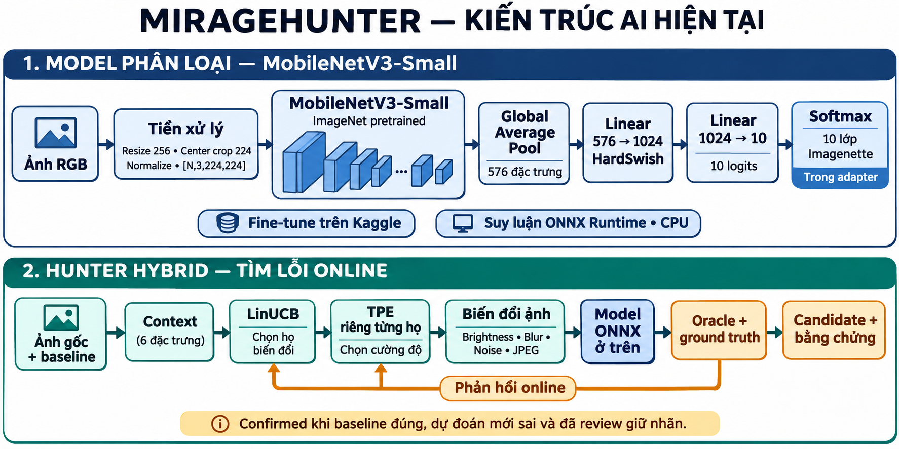

# Current MirageHunter AI architecture

The diagram below depicts the trained **demo target** and the shared Hunter.
The platform now also has an operator-reviewed configurable ONNX classification
adapter before that shared Hunter, with labelled-CSV loading and clean baseline
metrics. See [platform scope](ai-platform-scope.md) and
[classification contract](custom-classification.md). No second trained architecture
or object-detection adapter is claimed by this extension.

Verified against source and the exported ONNX on 17 November 2026. The classifier
weights have dimensions [1024,576] and [10,1024]. Deployment graph ends with global
average pooling, flatten, Linear 576→1024, HardSwish and Linear 1024→10. The CPU
adapter applies softmax outside ONNX. Training includes the torchvision classifier's
dropout, which is inactive in the exported evaluation graph.

The top panel groups the MobileNetV3-Small feature extractor, not every internal
convolution block. Input preprocessing resizes the shorter side to 256, center-crops
224×224 and applies ImageNet normalization to float32 NCHW.

Hybrid uses original-image/baseline context (six features), LinUCB family selection
and one TPE study per transform family. Ground truth and automatic quality screening
provide explicit proxy feedback. Semantic review is required to confirm induced
failures. The target classifier stays fixed during hunting.

Generated with built-in ImageGen. Prompt summary: “Draw the current MobileNetV3-Small
classifier and Hybrid LinUCB + per-family TPE loop in Vietnamese; keep exact tensor
dimensions, separate adapter softmax, Kaggle fine-tuning and ONNX CPU inference,
and distinguish candidates from reviewed confirmed failures.”
