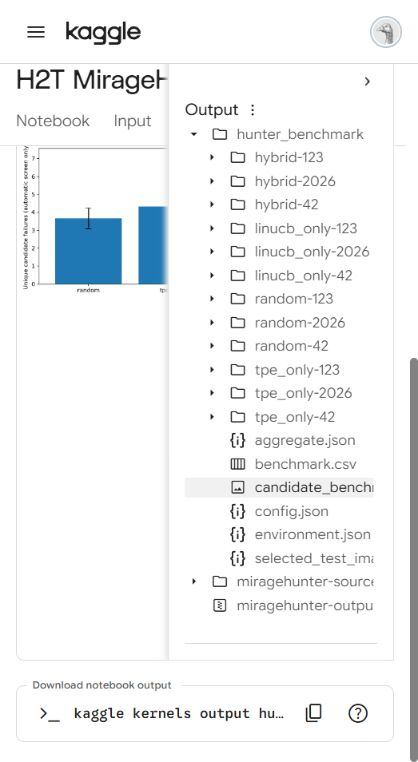
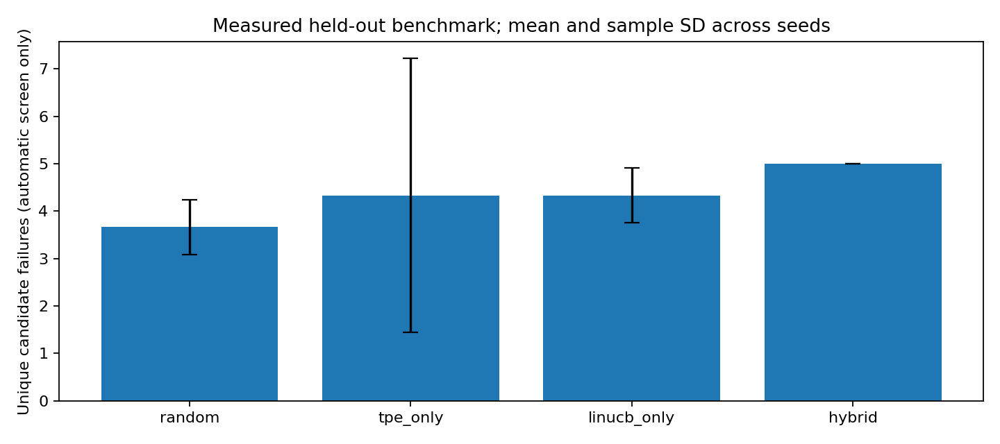

# Measured Kaggle Hunter benchmark

Observed 17 November 2026 in the Codex in-app browser. Kaggle
[run 370489176](https://www.kaggle.com/code/hungdeptrai123456/h2t-miragehunter-03-hunter-benchmark?scriptVersionId=370489176)
reported **179.3 second run - successful**. Execution used Save & Run All and CPU.
The notebook was copied from verified export run 370485049, with its embedded source
unchanged, then configured to execute the existing benchmark script. Kiro's prior
specification/review/test contributions remain recorded separately; this browser
execution and notebook adaptation were performed by Codex.

## Frozen protocol

- Four strategies, seeds 42/123/2026: 12 independent policy runs.
- Same fixed subset of 100 held-out images, with per-image hash checks.
- Clean subset accuracy: 92/100. Hunt sources exclude the eight incorrect baselines.
- 200 transformed-image queries per run; startup trials 10, minimization disabled.
- Actual total: 2,400 search queries plus 1,200 baseline inferences = 3,600 inferences.
- Source SHA256: `7b448bbdf36666d1359887c4218da12454f37418da50dfd5ed4f434b0ab71ed5`.
- ONNX SHA256: `100fd0a6d8c8a30599060a2738f5e1895560e14812221275095913d7c2048e6c`.

## Results

Values below are mean and sample standard deviation across three seeds.
Unique cases are counted by source image and corruption family within each run.

| Strategy | Candidate failures | Unique candidates | Mean hunt runtime |
| --- | ---: | ---: | ---: |
| Random | 4.33 +/- 0.58 | 3.67 +/- 0.58 | 9.67 s |
| TPE-only | 6.67 +/- 5.13 | 4.33 +/- 2.89 | 10.75 s |
| LinUCB-only | 5.67 +/- 0.58 | 4.33 +/- 0.58 | 9.92 s |
| Hybrid | 8.33 +/- 1.15 | 5.00 +/- 0.00 | 10.50 s |

All 12 rows report 200 search queries, 100 baseline queries, invalid rate zero and
confirmed failures zero. Hybrid has the largest observed mean candidate and unique
candidate counts in this small experiment. Three seeds and 100 images do not establish
general superiority or statistical significance. TPE-only varies substantially by seed.

Automatic screening does not establish semantic preservation. These are **candidate**
failures. Review exact original/transformed pixels against the true label before
promoting cases to confirmed. Zero confirmed cases means no semantic confirmation was
performed, not that the model is robust. Baseline accuracy here is on a smaller fixed
subset and is separate from the 96.80% accuracy measured on all 500 test images.

Peak process high-water was 194.32421875 MB on Kaggle Linux; this value accumulates
within the process and is not isolated per strategy. Hunt runtime excludes notebook
startup, dependencies, dataset extraction and output packaging. Neither value proves
production latency or a 512 MB deployment fit.

## Evidence and handoff

The Output tab lists the 12 strategy-seed directories, `benchmark.csv`, `aggregate.json`,
`candidate_benchmark.png`, config, environment, selected image manifest and the
263.64 MB `miragehunter-output.zip`. That archive contains per-trial evidence.
Both ZIPs have now been downloaded and passed CRC checks. Candidate evidence for all
75 candidate rows was extracted; three distinct saved cases replayed locally against
the hash-verified trained ONNX model. Semantic review has not been performed.

[`benchmark-370489176.csv`](benchmark-370489176.csv) transcribes the exact CSV printed
in the remote execution logs. It has subsequently been compared with the downloaded
`benchmark.csv` and all 12 parsed rows match exactly. Local arithmetic checks verified
three seeds per strategy and inference totals.
See [`kaggle-run-status.json`](kaggle-run-status.json) for the recorded execution facts.

